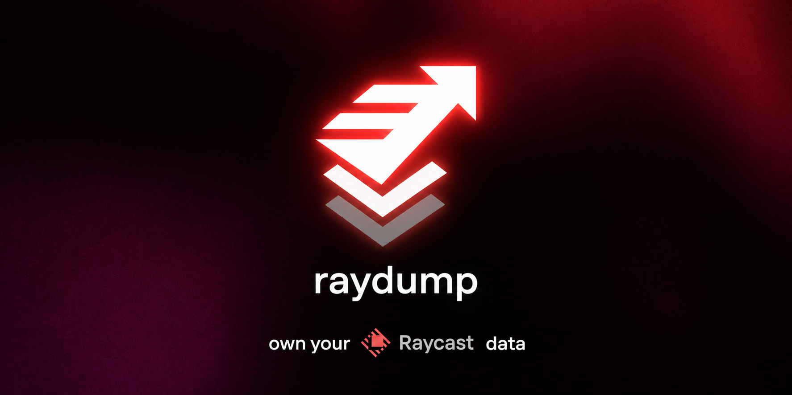
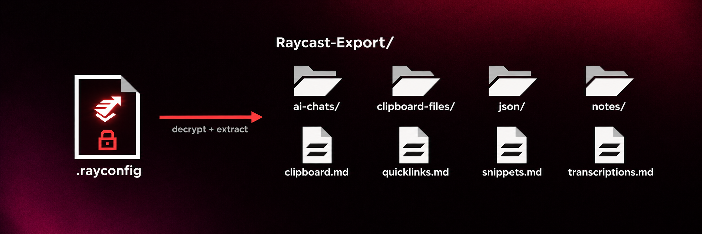
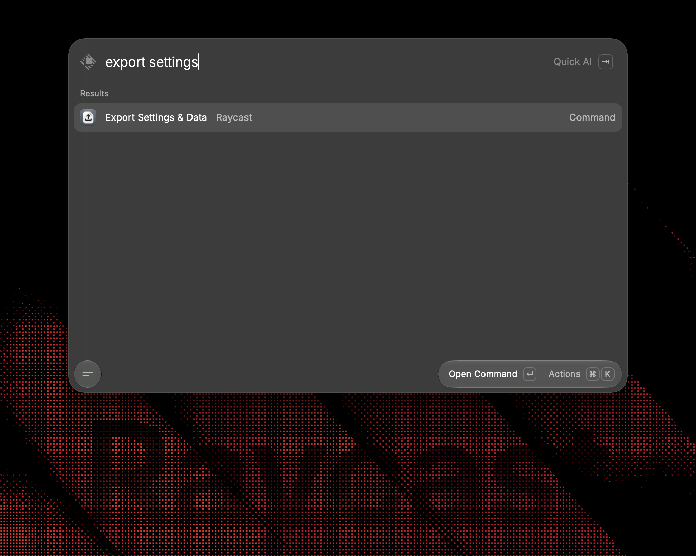
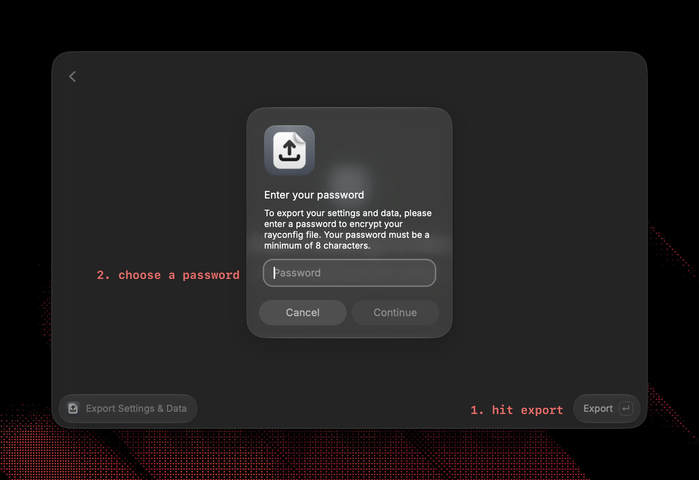
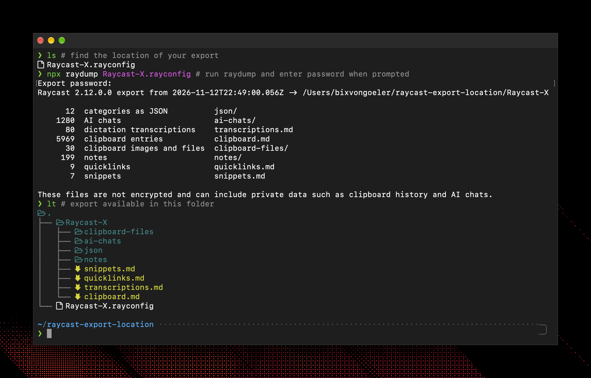
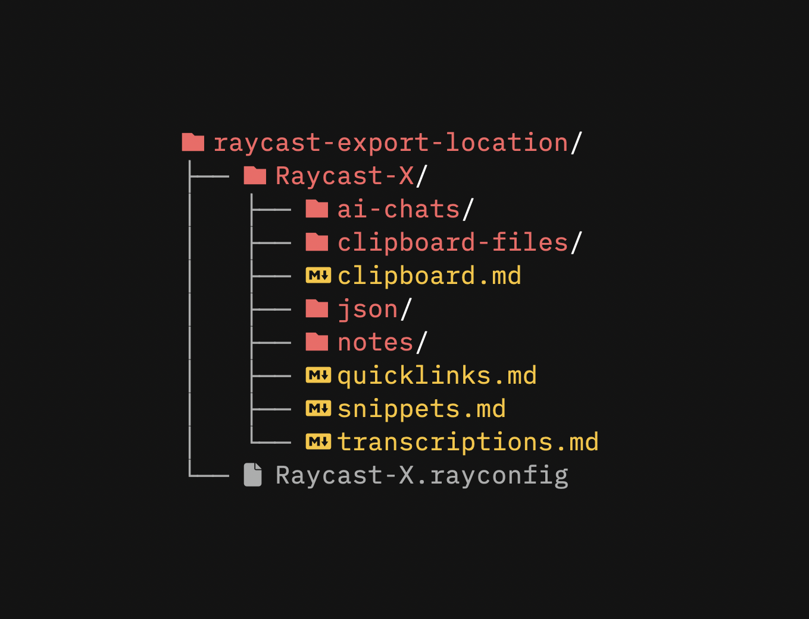

<p align="center">
  <a href="https://github.com/bixvongoeler/raydump"></a>
</p>
<!--<h1 align="center">
  raydump
</h1>-->

<p align="center">
  decrypt your Raycast export and get your notes, ai chats, snippets and more as markdown or json
</p>

---

<p align="center">
  <a aria-label="Latest release" href="https://github.com/bixvongoeler/raydump/releases/latest"></a>
  <a aria-label="MIT license" href="LICENSE"></a>
</p>

## About

Raycast only offers export through an _"Export Settings & Data"_ command resulting in an encrypted proprietary `.rayconfig` file. `raydump` is a small tool that allows you to extract your personal data to the raw Markdown and JSON files hidden within the export — allowing you to use **your** personal data _however_ you wish!

- `raydump` requires the export password you chose in Raycast during export to decrypt the `.rayconfig` file.
- It runs entirely on your computer and makes no network requests.
- It has no dependencies beyond Node.js.

<p align="center">
  <a href="https://github.com/bixvongoeler/raydump"></a>
</p>

## Quick Start

To use `raydump`, run the _"Export Settings & Data"_ command inside Raycast, save the `Raycast-X DATE.rayconfig` file, and then run `npx raydump "/path/to/your/Raycast-X DATE.rayconfig"` which will extract your data to a new folder containing your notes, AI chats, snippets, quicklinks, clipboard history and settings as Markdown and JSON files.

## Setup and Usage

<p align="center"></p>

1. Run the _"Export Settings & Data"_ command inside Raycast to save the `Raycast-X DATE.rayconfig` file.

<p align="center"></p>

2. Choose a password and save location for your export.

<p align="center"></p>

3. Run `npx raydump` with the path to your `.rayconfig` file. You will be asked for the export password, and the result is written to a folder named after the export.

    ```sh
    npx raydump "Raycast-X [DATE].rayconfig"
    ```

## Homebrew Install

If you want to run regular exports, or don't already have Node.js installed, get it with Homebrew:

```sh
brew install bixvongoeler/tap/raydump
raydump "Raycast-X [DATE].rayconfig"
```

Or with npm:

```sh
npm install -g raydump
```

## Files Produced

<p align="center"></p>

- The `json/` folder contains the complete export: settings, extensions, window layouts, themes, usage history, etc.
- The `markdown` files are generated from the `json` files to create human/agent readable views of key data categories.
- `settings.md` lists your settings, hotkeys, aliases and extensions in plain words, and `ai-memory.md` holds what Raycast AI has remembered about you.
- Notes and chats are dated with their real created and modified times, so they sort correctly in Finder or a notes app. Each note also carries a `raycast://` link that opens it in Raycast.

## Detailed CLI Usage

```
raydump <export.rayconfig> [options]

  -o, --output <dir>    Where to write (default: a folder named after the export)
  -p, --password <pw>   Export password
      --only <list>     Write only these sections (comma-separated)
      --skip <list>     Write everything except these sections
      --raw <file>      Write just the decrypted JSON, unchanged, to <file>
                        ("-" for standard output) and nothing else
  -f, --force           Write into an output folder that already has files in it
  -q, --quiet           Do not print the summary
  -h, --help            Show help
  -v, --version         Show the version

Sections: json, notes, chats, memory, transcriptions, snippets, quicklinks, clipboard, settings
```

Examples:

```sh
raydump export.rayconfig -o ~/Documents/raycast-backup
raydump export.rayconfig --only notes,snippets
raydump export.rayconfig --skip clipboard
raydump export.rayconfig --raw - | jq '.snippets'
```

### Password

The password is taken from the first of these that is set:

1. `--password`. Note that this leaves the password in your shell history.
2. The `RAYCAST_EXPORT_PASSWORD` environment variable.
3. A prompt, which does not show what you type.

Exports made without a password need none.

## Supported Exports

<div align="center">

| Export from                  | Decrypts | JSON | Markdown |
| ---------------------------- | :------: | :--: | :------: |
| Raycast 2.x (current format) |    ✓     |  ✓   |    ✓     |
| Raycast 2.x (earlier format) |    ✓     |  ✓   |    ✓     |
| Raycast 1.x                  |    ✓     |  ✓   |    ✓     |

</div>

## Privacy

> [!WARNING]
> The output is not encrypted. It can contain anything you have copied, dictated or typed into Raycast, including passwords and tokens in your clipboard history. Keep the folder somewhere private, and out of shared or synced locations unless you intend that.

`--skip clipboard` leaves the clipboard history out of the Markdown, but `json/clipboardHistory.json` still contains it. To leave it out completely, name what you do want, for example `--only notes,chats,snippets,quicklinks`.

`settings.md` names anything that looks like a credential, such as an API key or token, without showing it. The files in `json/` still contain those values.

## Limitations

- Raycast 1.x exports contain no clipboard history, dictation history or AI memory, so there is no `clipboard.md`, `transcriptions.md` or `ai-memory.md` for them.
- Most images and files in the clipboard history are not inside the export. Raycast stores them in its own data folder and the export only records their paths. `clipboard.md` lists those paths; the files are still on the computer that made the export.
- The export format is not documented by Raycast and may change. `raydump` reports an unknown format instead of guessing.

## Disclaimer

This project is not affiliated with or endorsed by Raycast. Raycast is a trademark of its owner.

## License

[MIT](LICENSE)
